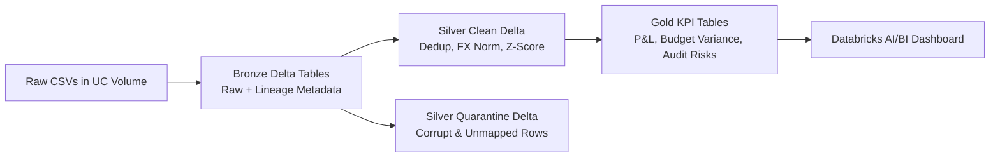
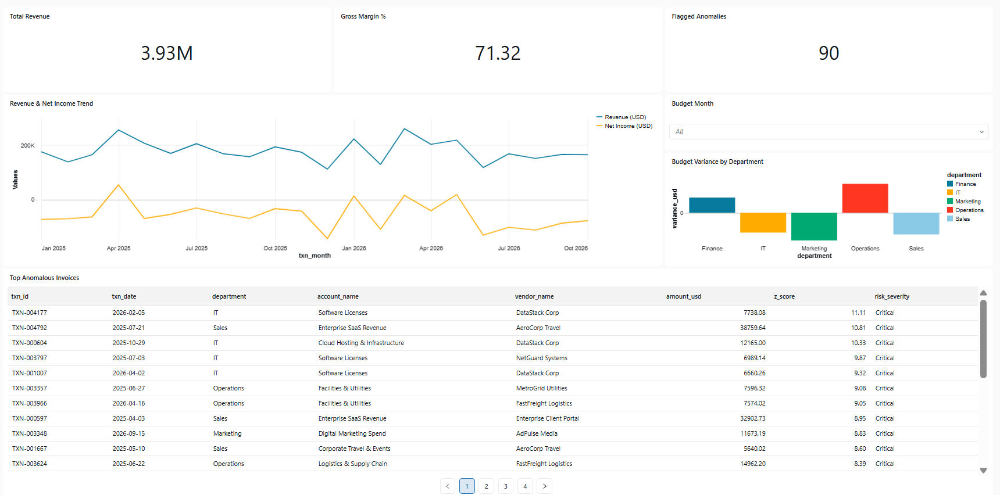

# Financial Medallion Lakehouse & Audit Anomaly Pipeline (Databricks)

End-to-end financial analytics and audit risk pipeline built on **Databricks (Unity Catalog, Delta Lake, PySpark, Spark SQL, AI/BI Dashboards)** using a synthetic multi-currency General Ledger dataset (~5,100 records).

## Architecture (Medallion Pattern)

## Key Features
- **Zero-Data-Loss Bronze Ingestion:** Captures raw CSV feeds from Unity Catalog Volumes into managed Delta tables with ingestion timestamps and source-file lineage (`_metadata.file_path`).
- **Automated Data Quality & Quarantine:** Deduplicates records via PySpark Window Functions, normalizes multi-currency transactions (`USD`, `EUR`, `GBP`, `CAD`) to USD, standardizes mixed date formats with ANSI-safe `try_to_date`/`try_cast`, and isolates defective rows into `silver_quarantine_transactions` with explicit failure reasons.
- **Statistical Audit Anomaly Detection:** Computes per-account Z-scores to flag high-risk billing spikes (`|Z| >= 3.0`) and classify severity (`High` vs. `Critical`).
- **Executive Financial Modeling (Gold Layer):** Produces Delta tables for Monthly P&L (Gross Margin %, MoM Revenue Growth via `LAG()`), Departmental Budget vs. Actual Variance, and an Audit Risk Register.

## Dashboard Preview

## Tech Stack
`Databricks` | `PySpark` | `Spark SQL` | `Delta Lake` | `Unity Catalog` | `Python` | `AI/BI Dashboards`

## How to Reproduce
1. Run `python src/generate_financial_data.py` to create the 3 CSV files in `sample_data/`.
2. Sign up for **Databricks Free Edition** and run `CREATE VOLUME IF NOT EXISTS workspace.default.raw_finance;`.
3. Upload the CSVs to `/Volumes/workspace/default/raw_finance/`.
4. Run notebooks `01` through `03` in order and connect the `gold_*` tables to an AI/BI Dashboard.

## 📄 License

MIT License © <a href="https://github.com/eapinedo/databricks-financial-lakehouse/blob/main/LICENSE.txt">Emilio Pinedo</a>

